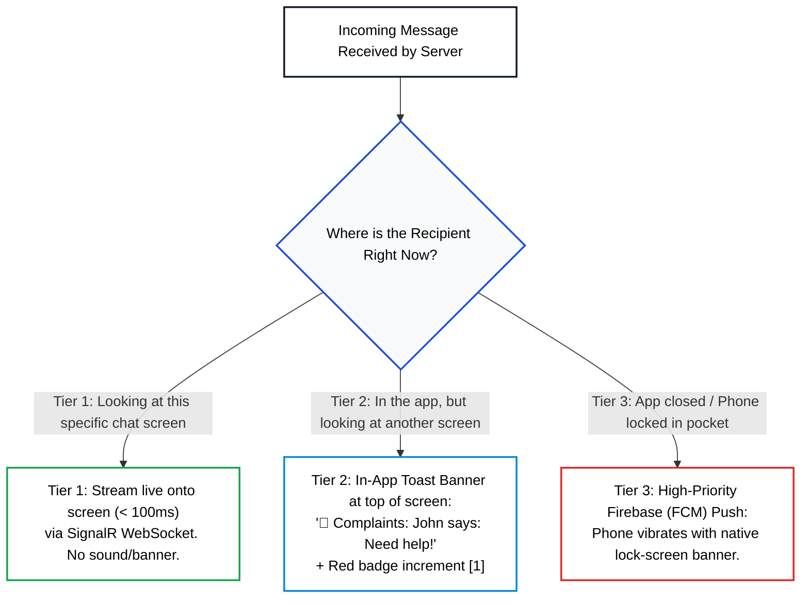

# Departmental Real-Time Chat System
## Business Domain & Functional Specification

---

## 1. Domain Philosophy & Overview

This system is a **direct, real-time messaging application** designed for mobile devices (iOS & Android). 

### Key Principles:
* **No Ticket System**: The application rejects traditional helpdesk concepts such as ticket numbers, ticket priority, and "Open/Resolved/Closed" statuses.
* **Direct Room Model**: Just like WhatsApp or Telegram, a user sees a directory of departments (e.g., *Complaints*, *IT Support*, *Billing*) and can immediately open an ongoing, continuous chat room with any department.
* **Full-Stack C# Architecture**: Built with .NET MAUI on mobile, ASP.NET Core SignalR on the backend, SQL Server for persistence, Redis for presence and scaling, and Firebase (FCM) for sleeping device wake-ups.

---

## 2. Roles, Permissions & Account Provisioning

The system defines three distinct actors:

```
┌─────────────────┬──────────────────────┬────────────────────────────────────────────────────────┐
│ ROLE            │ PROVISIONING         │ PERMISSIONS & SCOPE                                    │
├─────────────────┼──────────────────────┼────────────────────────────────────────────────────────┤
│ 1. Admin        │ Seeded into Database │ • Creates and manages departments.                     │
│                 │ (System Owner)       │ • Master Key: Can view all departments, browse any     │
│                 │                      │   user's chat room, and reply to any user inquiry.     │
├─────────────────┼──────────────────────┼────────────────────────────────────────────────────────┤
│ 2. Manager      │ Seeded / Assigned by │ • Assigned to one or more specific departments.        │
│                 │ Admin (Staff)        │ • Can view all user chat rooms within their assigned   │
│                 │                      │   department(s) and reply to help those users.         │
├─────────────────┼──────────────────────┼────────────────────────────────────────────────────────┤
│ 3. User         │ Public Self-Signup   │ • The only role allowed via the public signup form.    │
│                 │ (Customer / Employee)│ • Can view the directory of active departments.        │
│                 │                      │ • Can initiate a private chat room with any department.│
│                 │                      │ • Strictly restricted to their own conversations.      │
└─────────────────┴──────────────────────┴────────────────────────────────────────────────────────┘
```

---

## 3. Confidentiality & Isolation Rules (The Golden Rule)

1. **User-to-User Isolation**:
   * If **User John** starts a chat room in *"Complaints"*, **only John, the Complaints Managers, and Admins can see or access that room**.
   * Another regular user (**Alice**) who also contacts *"Complaints"* will have her own separate, confidential room. Alice can **never** see John’s messages, John's name, or John's room existence.
2. **Department Isolation for Managers**:
   * A manager assigned exclusively to *"Complaints"* cannot see user chat rooms inside *"IT Support"* or *"Billing"*.
   * Only **Admins** have unrestricted cross-department visibility.

---

## 4. The 3-Tier Real-Time Awareness Model

Both Users and Managers can have multiple active conversations simultaneously (e.g., a Manager handling Complaints & Tech Support; a User chatting with Complaints & Billing). 

To prevent alert fatigue and battery drain, the system maintains **ONE single persistent WebSocket connection** per phone and categorizes message delivery into 3 tiers:



---

## 5. Multi-Manager & Multi-Room Orchestration

### Rule 1: Outgoing Staff Replies
* When Manager 1 replies to User John, **only User John is notified**.
* Other department managers (Manager 2) are **not** spammed with push notifications for their colleague's replies.

### Rule 2: Active Conversation Handling
* If Manager 1 is actively inside John's chat room chatting live, and John sends another message:
  * Deliver to Manager 1 via SignalR.
  * **Suppress push notifications to Manager 2** (Manager 1 is already handling the conversation).

### Rule 3: Unattended User Inquiries
* If John sends a new message to *"Complaints"* and **no manager is currently inside that room**:
  * Broadcast an In-App Toast to all managers currently open in the app.
  * Trigger an **FCM Push Notification** to all offline Complaints Managers and Admins so whoever is available can open the app and respond.

---

## 6. 100% Deliverability & Reliability Guarantees

The architecture guarantees zero lost messages and zero duplicate bubbles through four synchronized mechanisms:

```
┌────────────────────────────────┬────────────────────────────────────────────────────────┐
│ MECHANISM                      │ HOW IT GUARANTEES RELIABILITY                          │
├────────────────────────────────┼────────────────────────────────────────────────────────┤
│ 1. Client SQLite Outbox        │ If a user taps "Send" in an elevator, the message is   │
│    (Sender Guarantee)          │ saved locally as PENDING ⏳ with a UUID. It flushes    │
│                                │ automatically the instant cell signal returns.         │
├────────────────────────────────┼────────────────────────────────────────────────────────┤
│ 2. Idempotency Constraint      │ SQL Server enforces UNIQUE(RoomId, ClientGeneratedId). │
│    (Deduplication Guarantee)   │ Network retries can never generate duplicate bubbles.  │
├────────────────────────────────┼────────────────────────────────────────────────────────┤
│ 3. Delta Catch-Up Sync         │ Messages receive incrementing Sequence Numbers (#1,    │
│    (Receiver Guarantee)        │ #2...). Upon reconnecting, phones call                 │
│                                │ GET /sync?since=45 to download missed messages.        │
├────────────────────────────────┼────────────────────────────────────────────────────────┤
│ 4. 5-Second ACK Timeout        │ If the server pushes via WebSocket and no delivery ACK │
│    (Dead Socket Fallback)      │ returns within 5s, it falls back to Firebase Push.     │
└────────────────────────────────┴────────────────────────────────────────────────────────┘
```

---

## 7. Technology Stack Specifications

* **Mobile Client**: **.NET MAUI** (Android / iOS)
  * Local Storage: **SQLite** (`sqlite-net-pcl`)
  * Real-Time Client: `Microsoft.AspNetCore.SignalR.Client`
* **Compute / API**: **ASP.NET Core 8 / 9**
  * REST Endpoints (Auth, Department List, Delta Sync, Media)
  * SignalR `ChatHub` (WebSocket duplex streaming & room management)
* **Presence & Scaleout**: **Redis** (`StackExchange.Redis`)
  * Sub-millisecond Presence Directory (`online_users:{id}`)
  * Multi-server SignalR Pub/Sub Backplane
* **Persistence**: **SQL Server** (`Microsoft.EntityFrameworkCore.SqlServer`)
  * ACID persistence, monotonic sequence generators, unique index constraints
* **Push Notification Gateway**: **Firebase Cloud Messaging (FCM)**
  * Managed via official Google `FirebaseAdmin` SDK in .NET

---

## 8. Current Implementation Status

### Completed:
* [x] Scaffolded 5-layer Clean Architecture solution:
  * `DeptChat.Shared` (DTOs & enums shared between MAUI and Backend)
  * `DeptChat.Domain` (Core business models)
  * `DeptChat.Application` (Business rules & handlers)
  * `DeptChat.Infrastructure` (EF Core SQL Server, Redis, FCM)
  * `DeptChat.WebApi` (REST API & SignalR Hub)
* [x] Installed all required NuGet packages.
* [x] Created Shared Enums: `UserRole`, `ConversationStatus`, `MessageDeliveryStatus`.
* [x] Created Domain Entities: `User`, `Department`, `DepartmentManager`, `Conversation`, `Message`, `DeviceToken`.
* [x] Verified full solution compilation: **`Build succeeded (0 Errors, 0 Warnings)`**.

### Next Session Agenda:
1. **EF Core `ApplicationDbContext`**:
   * Configure Fluent API mappings and unique constraints (`RoomId + ClientGeneratedId`).
   * Seed the default **Admin** account and **Manager** account.
2. **Database Migration**:
   * Run the initial migration to generate the SQL Server schema.
3. **Authentication Endpoints**:
   * Implement `POST /api/auth/register` (hardcoded strictly to `Role = User`).
   * Implement `POST /api/auth/login` (JWT token issuance).
